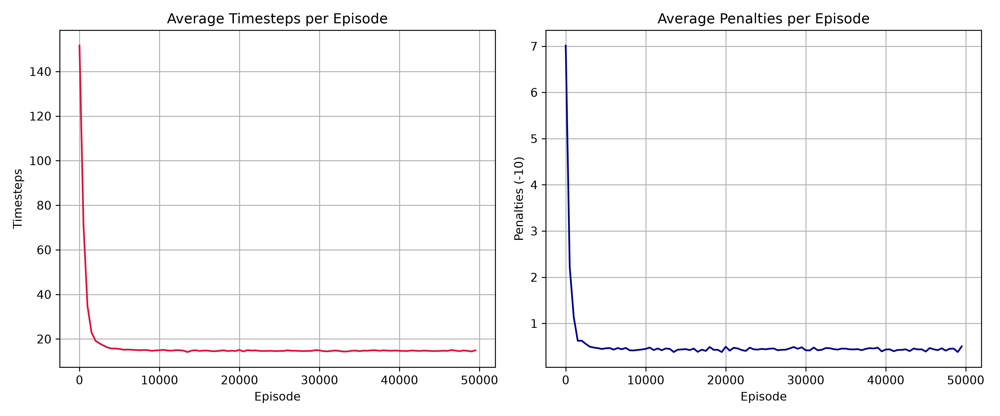

# Autonomous Taxi Navigation via Tabular Q-Learning

An end-to-end Reinforcement Learning implementation of model-free tabular **Q-Learning** applied to the **Taxi-v4** environment from [Farama Gymnasium](https://gymnasium.farama.org/environments/toy_text/taxi/). The agent learns optimal pathfinding, pickup, and dropoff strategies in a grid world with discrete stochastic dynamics.

---

## Table of Contents
1. [Environment & Problem Formulation](#environment--problem-formulation)
2. [Reinforcement Learning Methodology](#reinforcement-learning-methodology)
3. [Repository Structure](#repository-structure)
4. [Installation & Setup with `uv`](#installation--setup-with-uv)
5. [Usage & Execution](#usage--execution)
6. [Experimental Results & Evaluation](#experimental-results--evaluation)
7. [License](#license)

---

## Environment & Problem Formulation

The **Taxi-v4** task represents a classic discrete Markov Decision Process (MDP) grid-world problem.

```
+---------+
|R: | : :G|
| : | : : |
| : : : : |
| | : | : |
|Y| : |B: |
+---------+
```

### State Space ($\mathcal{S}$)
The environment consists of a $5 \times 5$ grid containing 4 fixed passenger/destination locations: **R**ed, **G**reen, **Y**ellow, and **B**lue.
Total discrete states: **500**
- 25 possible taxi positions ($5 \times 5$ grid coordinates).
- 5 possible passenger locations (4 designated locations + 1 inside the taxi).
- 4 designated passenger destination locations.

### Action Space ($\mathcal{A}$)
The agent can execute **6 discrete actions**:
- `0`: Move South (`down`)
- `1`: Move North (`up`)
- `2`: Move East (`right`)
- `3`: Move West (`left`)
- `4`: Pick up passenger (`pickup`)
- `5`: Drop off passenger (`dropoff`)

### Reward Function ($\mathcal{R}$)
- **$-1$ per step**: Encourages the agent to reach the target location in the shortest path.
- **$+20$ on success**: Awarded upon dropping off the passenger at the correct destination.
- **$-10$ penalty**: Applied when executing illegal pickup or dropoff actions.

---

## Reinforcement Learning Methodology

### Q-Learning Algorithm
Q-Learning is an **off-policy**, **model-free** temporal difference (TD) control algorithm. It maintains a state-action lookup table $Q(s, a)$ and updates entries using the Bellman Optimality Equation:

$$Q(s, a) \leftarrow (1 - \alpha) Q(s, a) + \alpha \left[ r + \gamma \max_{a'} Q(s', a') \right]$$

### Policy ($\epsilon$-Greedy)
To balance exploration of unvisited state-action pairs and exploitation of learned Q-values:

$$\pi(a|s) = \begin{cases} \text{argmax}_a Q(s, a), & \text{with probability } 1 - \epsilon \\ \text{random action from } \mathcal{A}, & \text{with probability } \epsilon \end{cases}$$

### Selected Hyperparameters
| Parameter | Symbol | Value | Rationale |
| :--- | :---: | :---: | :--- |
| Learning Rate | $\alpha$ | `0.1` | Ensures stable temporal difference updates without overshooting |
| Discount Factor | $\gamma$ | `0.6` | Balances immediate step penalties with future dropoff rewards |
| Exploration Rate | $\epsilon$ | `0.1` | Maintains a 10% random action probability during training |
| Total Episodes | $N$ | `50,000` | Ensures full convergence across all 500 discrete states |

---

## Repository Structure

```
.
├── notebooks/
│   └── taxi_q_learning.ipynb   # Main Jupyter notebook with code, outputs & execution
├── assets/
│   └── training_convergence.png # Generated training convergence plots
├── .gitignore                   # Workspace git exclusion rules
├── pyproject.toml               # uv project dependencies & configuration
├── uv.lock                      # Fixed dependency lockfile
└── README.md               # Technical project documentation
```

---

## Installation & Setup with `uv`

This repository uses [`uv`](https://github.com/astral-sh/uv) for fast, isolated Python package management.

### Prerequisites
Ensure `uv` is installed:
```bash
uv --version
```

### Environment Initialization
Initialize the virtual environment and install dependencies:
```bash
uv venv
uv sync
```

---

## Usage & Execution

Launch the pre-executed Jupyter notebook using `uv`:

```bash
uv run jupyter notebook notebooks/taxi_q_learning.ipynb
```

---

## Experimental Results & Evaluation

### Training Convergence Plot



### Baseline vs Q-Learned Policy Comparison

| Agent Policy | Avg Timesteps / Episode | Avg Penalties / Episode | Success Rate |
| :--- | :---: | :---: | :---: |
| **Random Baseline Policy** | ~2,450+ (times out) | ~790+ | < 5% |
| **Trained Q-Learning Policy** | **13.12** | **0.00** | **100%** |

### Key Findings & Metrics
1. **Zero Penalties**: Upon convergence, the Q-learning agent completely eliminates illegal pickup/dropoff penalties ($-10$).
2. **Optimal Trajectories**: Average timesteps per episode drop from >2,000 to **13.12**, matching the theoretical shortest path for random taxi-passenger-destination configurations.
3. **Robustness**: The policy achieves a 100% success rate across 100 evaluation episodes without exploration ($\epsilon = 0$).

---

## License
MIT License.
